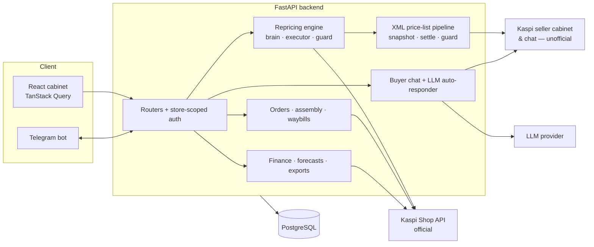

# BuyShark — automation SaaS for Kaspi.kz sellers

*[Русская версия](README.ru.md)*

**Kaspi.kz** is Kazakhstan's dominant super-app — marketplace, payments and banking in one,
roughly what Amazon + PayPal would be if they were the same company. Its sellers compete on
price for a shared product card, so repricing ("dumping") bots are standard equipment.

BuyShark was a SaaS for those sellers: competitive repricing with safeguards, detection of
rival bots, order assembly and batch waybill printing, a buyer chat with an LLM auto-responder,
and store finance/analytics. It ran in production on real stores from July to October 2026.

> The business is closed; the code is published as a portfolio piece. Below is an honest account
> of what was built, what broke, and why the product did not find a market.

## By the numbers

- **~3 months** of work, July → October 2026, with the commit history preserved
- **~83,000 lines**: backend ~40k (Python), frontend ~22k (TypeScript), tests ~22k
- **1,570 tests** in the public version, run in CI
- one developer working with AI coding agents (Claude Code)

## Architecture



| Module | Where | What it does |
|---|---|---|
| **Repricing engine** | `backend/dumper/` | Decides the price per SKU from the market snapshot and the seller's floor/ceiling/step rules, then rolls prices out two ways: point updates through the cabinet and bulk updates through the XML price list |
| **Price-list safety** | `dumper/feed_*.py` | Kaspi's price list is a full snapshot, not a diff. Snapshots, rollback, identity checks and a guard so an upload can never silently pull offers off sale |
| **Rival-bot detection** | `dumper/guard.py`, `services/dumping_attacks.py` | Spots competing bots from bidding patterns; estimates a seller's account age from the sequential merchant id; weekly attack report |
| **Orders & waybills** | `services/auto_assembly_*`, `print_batcher_service.py` | Order sync, auto-assembly, batch waybill printing (thermal 75×120 / 100×150, A4) grouped by SKU category |
| **Buyer chat** | `backend/chatbot/`, `routers/chats.py` | Our own UI over Kaspi's chat; LLM auto-responder that gets the order facts in context and logs every answer |
| **Finance** | `order_finance.py`, `stock_forecast.py`, `sales_export.py` | 2026 Kaspi commission table, margin on closed orders, stock forecast, exports |
| **Platform** | `security/`, `billing/`, `routers/` | Multi-tenant stores with roles and employees, tariffs and referrals, public API with keys, webhooks, Telegram notifications |
| **Frontend** | `frontend/` | React 19 + Vite + TanStack Query, i18n (Russian/Kazakh), Recharts |

**Stack:** Python 3.13, FastAPI, SQLAlchemy 2 (async) + asyncpg, PostgreSQL, Alembic, aiogram 3,
httpx, Playwright, Sentry, Prometheus · React 19, TypeScript, Vite, Bun · GitHub Actions,
systemd and nginx on a single VPS, deploys with a health check and automatic rollback (`deploy.sh`).

Code comments and commit messages are mostly in Russian.

## Architecture decisions

The [ADR index](docs/adr/README.md) records the main design choices, alternatives and trade-offs.

## Post-mortems

- **A 2-SKU test price list took ~800 offers off sale.** Kaspi treats the XML price list as the
  complete catalogue, so everything missing from the file is withdrawn. Offers were restored by
  hand overnight. That incident is why the feed pipeline has snapshots, a guard and rollback, and
  why the feed was disabled until uploads were provably safe.
- **"Pickup" did not exist as a delivery type.** Locker delivery and self-pickup share the same
  `deliveryMode` (`DELIVERY_PICKUP`); the real discriminator is `isKaspiDelivery`. Every self-pickup
  was counted as a locker until the numbers were reconciled against the owner's cabinet.
- **The server's IP got blocked by Kaspi's WAF.** Most likely repeated reads of the same public
  product pages from a datacenter IP were enough to get the range blocked. The product could not run reliably from then
  on — one of the reasons it was stopped.
- **Deploys rolled back silently.** `deploy.sh` reverts on a failed health check, while `git log` on
  the server keeps showing the new commit. The source of truth became `.last_good_sha`.
- **SKUs with tabs or trailing spaces do not survive the price list** — Kaspi normalizes them and
  archives the offer.

## Why it did not take off

The product worked; the market was already taken. By launch, nearly every active seller was on a
competitor's repricing bot. The one free segment was brand-new sellers without a bot: the last
outreach to 30 of them, each with a personal offer starting at 1,000 ₸, converted 0. On top of that
came structural risk: key integrations depend on unofficial interfaces Kaspi can change at any time.

## LLM autoresponder: quality in production

- A manual review of 195 buyer-chat exchanges from one store (2–19 Oct 2026, DeepSeek chat model).
- Of 167 model replies, **84 % (95 % CI 78–89) had no visible problem**; 4 % (2–8) held a likely
  invented fact and 4 % (2–8) should have gone to a human.
- Of 28 hand-offs the model started, 25 % (13–43) were unnecessary; 28 % of all exchanges ended in a hand-off.
- One store, 18 days, one annotator reviewing LLM first-pass labels, no order data for the annotator.
- Method, tables, failure analysis and examples: [docs/AUTORESPONDER_EVAL.md](docs/AUTORESPONDER_EVAL.md).

## What is not published

Some modules are replaced by interface stubs (marked `WITHHELD`) in this repository and in its
entire history:

- **Kaspi seller-cabinet login automation** — email/password and one-time-code login, phone+SMS
  login for the chat, one-click store connection that creates an employee account in the cabinet.
- **The market radar's transport layer** — how competitor offers were collected from Kaspi's
  public pages despite its bot protection. The radar's interface remains; here it returns an empty
  market, so the engine never moves a price.
- **Seller quality metrics** — read from the cabinet's internal GraphQL API.

I don't publish code whose purpose is to get around another platform's protections. The decision
logic around these modules is open; the full code can be shown in a live walkthrough on request.

## Running it

```bash
python -m venv venv && venv/bin/pip install -r requirements-dev.txt
pytest tests/                      # 1,570 tests, no external services needed
cd frontend && bun install && bun run dev
```

Backend: `start.sh` / `start.bat`; without `DATABASE_URL` it falls back to a local SQLite.
Real use needs a Kaspi Shop API token.

## Notes

Not affiliated with Kaspi.kz. Client data in the history is anonymized: store names, SKUs,
merchant and product ids are replaced with fictional ones ("Barkhan" is not a real store).

License: [Attribution License](LICENSE) — free to use, modify and sell, credit "Venius24 & Buyshark" is required.
