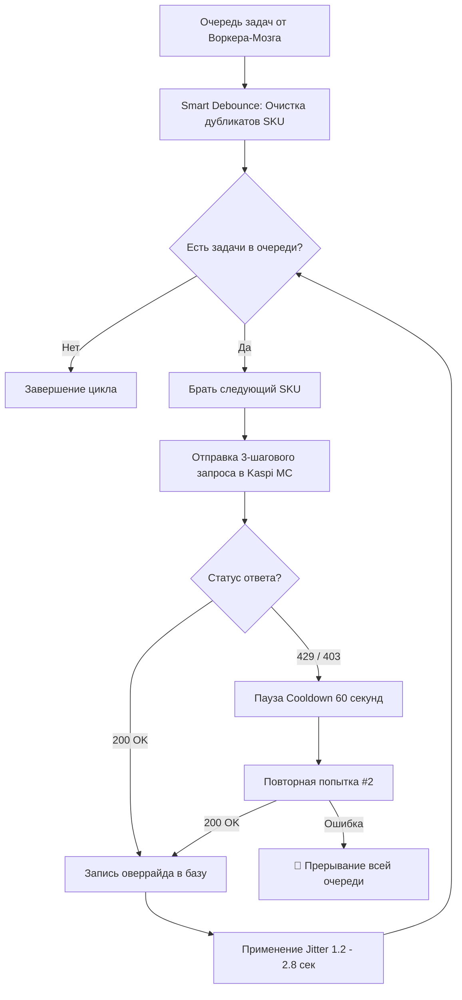

# 🛡️ Антифрод-защита и регламент Воркера-Исполнителя (Rate-Limiting & Safety Rules)

Документ описывает защитные механизмы, встроенные в **Воркер-Исполнитель (`RateLimitExecutorWorker`)** для предотвращения блокировок со стороны антифрод-системы Kaspi.kz при автоматическом демпинге и изменении цен.

---

## 🔑 Ключевые нормы и правила защиты

### 1. 🧹 Smart Debounce (Дедупликация задач)
* **Проблема:** При частых расчетах или одновременных событиях в очередь может попадать несколько команд на изменение цены одного и того же `SKU`.
* **Решение:** Перед отправкой запросов Воркер-Исполнитель автоматически сжимает очередь. Для каждого `SKU` сохраняется **только последнее (самое свежее) значение цены**, а устаревшие промежуточные задачи сбрасываются.
* **Результат:** Экономия лимита запросов и исключение лишней нагрузки на API Kaspi MC.

---

### 2. 🎲 Jitter & Micro-delays (Рандомизация задержек)
* **Проблема:** Запросы с фиксированным равным интервалом (например, строго 1.0 сек) легко распознаются алгоритмами Kaspi как паттерн бота.
* **Решение:** Вместо статической задержки используется случайный плавающий интервал (Jitter):
  $$\text{delay} = \text{random.uniform}(1.2, 2.8) \text{ секунд}$$
* **Результат:** Поведение скрипта визуально имитирует работу живого менеджера, переключающего позиции в кабинете продавца.

---

### 3. 🛡️ Backoff при 429 / 403 (Защитная заморозка)
* **Проблема:** Игнорирование ответов `429 Too Many Requests` или `403 Forbidden` приводит к накоплению ошибок и жесткой блокировке сессии/IP.
* **Алгоритм реактивного сброса:**
  1. При получении статуса `429` или `403` воркер приостанавливает выполнение очереди и встает на **паузу остывания (Cooldown) на 60 секунд**.
  2. В журнал выводится предупреждение: `⚠️ Обнаружен блок 429/403. Включаем Backoff: пауза 60 секунд...`.
  3. По истечении 60 секунд выполняется **одна повторная попытка** для текущего товара.
  4. Если повторный запрос снова возвращает ошибку, воркер **полностью прерывает обработку очереди** для предотвращения бана аккаунта.

---

## 📑 Пошаговая схема работы Исполнителя

