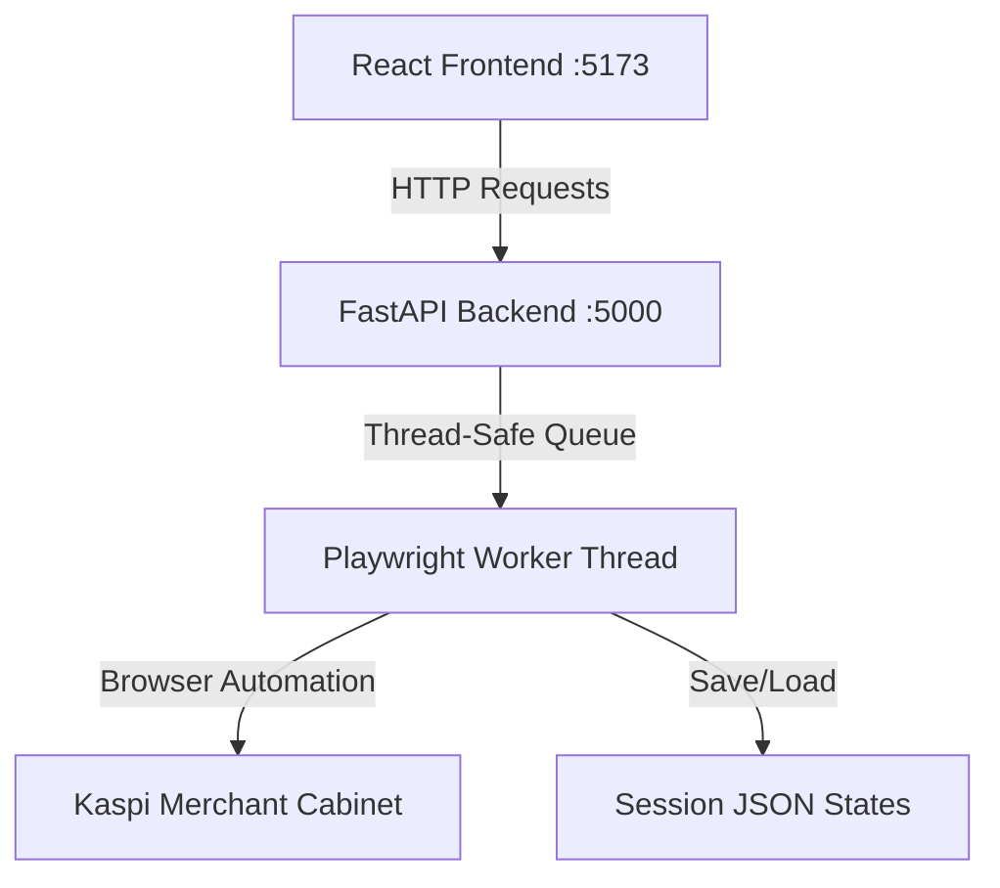

# Структура и устройство проекта Kaspi MC SaaS Wrapper

Этот файл описывает архитектуру, компоненты и принципы работы проекта автоматизации личного кабинета Kaspi Merchant Cabinet (FastAPI + React Vite + Playwright).

---

## Архитектура системы

Проект спроектирован по клиент-серверной архитектуре и состоит из трех основных частей:
1. **Frontend (React + Vite)** — пользовательский интерфейс для управления кабинетами, ценами, остатками, сборкой и передачей заказов.
2. **Backend (FastAPI)** — HTTP-сервер, который координирует работу Playwright в фоновом режиме.
3. **Playwright Automation Layer** — автоматизатор браузера Chromium, выполняющий реальные действия в кабинете продавца Kaspi.



---

## Структура директорий и файлов

```bash
.
├── backend/                  # Бэкенд-часть (Python FastAPI)
│   ├── main.py               # Главный файл сервера, роуты API и Worker-поток
│   ├── kaspi_wrapper.py      # Реализация скрапинга и автоматизации действий Kaspi MC
│   ├── states/               # Директория с сохраненными сессиями (sessionStorage / cookies)
│   └── src/                  # Исходный код на TypeScript (альтернативная версия)
│       └── automation/
│           └── kaspi.ts
│
├── frontend/                 # Фронтенд-часть (React + Vite + TypeScript)
│   ├── src/
│   │   ├── App.tsx           # Основной компонент панели управления
│   │   ├── index.css         # Стили интерфейса (Glassmorphism, Dark mode)
│   │   └── main.tsx          # Точка входа React
│   └── package.json          # Зависимости фронтенда
│
├── pythonlegacy/             # Исторические Playwright-скрипты генерации (codegen)
│   ├── codegen.py
│   ├── codegen3.py
│   └── codegen4.py
│
├── start.sh                  # Запуск проекта для Bash/macOS/Linux
├── start.bat                 # Запуск проекта для Windows (CMD / PowerShell)
└── STRUCTURE.md              # Данное описание структуры
```

---

## Подробное описание компонентов

### 1. Бэкенд (Python FastAPI)

#### [backend/main.py](file:///f:/Dev/sbx/backend/main.py)
* Инициализирует FastAPI сервер на порту `5000`.
* Содержит класс `PlaywrightWorker(threading.Thread)`, работающий в фоновом потоке. Он использует синхронный API Playwright (`sync_playwright`) и обрабатывает задачи через потокобезопасную очередь `queue.Queue`. Это гарантирует, что одновременно выполняется только одна браузерная операция на один рабочий поток, исключая гонки и конфликты сессий Chromium.
* Осуществляет роутинг входящих запросов к очередям воркера (`start-login`, `submit-sms`, `products`, `product-action`, `orders`, `orders/pack`, `orders/pack-all`).

#### [backend/kaspi_wrapper.py](file:///f:/Dev/sbx/backend/kaspi_wrapper.py)
Содержит статические методы класса `KaspiWrapper`, автоматизирующие интерфейс Kaspi:
* `scrape_products` — переходит в раздел товаров, дожидается полной отрисовки SPA-контента с помощью `networkidle`, парсит активные/архивные товары (название, SKU, цена, статус, ссылка) и рассчитывает пагинацию.
* `perform_product_action` — изменяет цену, остатки, архивирует или повторно публикует товар.
* `fetch_orders` — собирает заказы со статусом `NEW` или `KASPI_DELIVERY_CARGO_ASSEMBLY` (На сборке). Поддерживает циклическую пагинацию (перелистывание страниц) до достижения указанного лимита, логирует постраничный прогресс и помечает каждый заказ его исходной страницей (`pageNumber` / `_sourcePage`).
* `pack_order` — открывает страницу со списком заказов на нужной странице (`&page=X`), находит чекбокс конкретного заказа по его ID, нажимает его и кликает «Сформировать накладные».
* `pack_all_orders` — массово выбирает все заказы на текущей странице и формирует для них накладные за один проход.
* `fetch_transfers` — собирает данные по передаче собранных заказов курьеру с поддержкой фильтров (Все, Экспресс, Сегодня).

### 2. Сохранение сессий (`states/`)
После прохождения SMS-авторизации, состояние сессии (куки, локальное хранилище) сохраняется в JSON-файл в директории `backend/states/state_{номер_телефона}.json`. При последующих запросах Playwright запускает Chromium в `headless` режиме с предзагруженным файлом состояния, минуя необходимость повторного ввода SMS.

### 3. Фронтенд (React + Vite)

#### [frontend/src/App.tsx](file:///f:/Dev/sbx/frontend/src/App.tsx)
Основная SPA-панель управления. Функционал разбит на вкладки:
* **Подключение кабинетов**: интерфейс авторизации по номеру телефона и SMS.
* **Вкладка «Товары»**: таблица товаров, поиск, фильтр по статусу (в продаже/сняты), изменение цены и остатков через модальное окно.
* **Вкладка «Упаковка»**: сборка заказов. Содержит селектор лимита (10, 20, 50, 100 заказов), чекбокс «Выбрать все» и кнопку «Сформировать все накладные» для массовой упаковки.
* **Вкладка «Передача»**: список заказов к передаче с адресами доставки и фильтрами по типам.
* **Логи событий**: терминальное окно в нижней левой части экрана, дублирующее действия автоматизатора в реальном времени.

---

## Запуск проекта

Запуск осуществляется в два клика с помощью скриптов в корневой директории:
* **На Windows**: запустить [start.bat](file:///f:/Dev/sbx/start.bat) (откроет бэкенд и фронтенд в новых консольных окнах).
* **На Linux / macOS**: запустить `./start.sh`.
